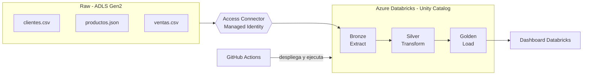
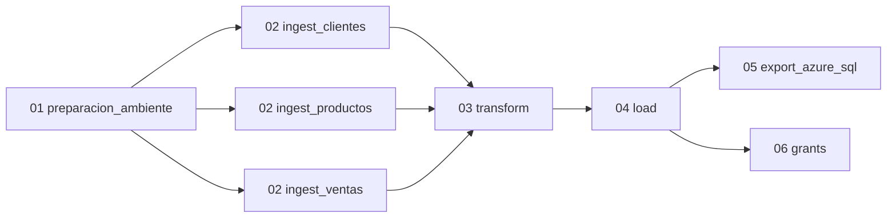

# Proyecto Final - Ingeniería de Datos con Databricks

**Autor:** Bruno Mauricio Tarco Romero

ETL sobre Azure Databricks con arquitectura medallion (bronze, silver y golden), desarrollado en PySpark y desplegado de desarrollo a producción con GitHub Actions.

## Caso de negocio

Se trabajó con las ventas de una cadena de tiendas en el Perú (tecnología, muebles y artículos de oficina) entre 2023 y 2025, en 13 ciudades de Costa, Sierra y Selva y por cuatro canales de venta (web, app, tienda y televenta). El objetivo es responder:

- Cómo evolucionan las ventas y la utilidad por categoría mes a mes.
- Quiénes son los clientes de mayor valor y cuáles dejaron de comprar.
- Qué productos concentran la venta dentro de cada categoría.
- Qué región y canal venden más y cuál cumple mejor los tiempos de envío.

## Insumos

Se usaron tres archivos ubicados en el contenedor `raw` del Data Lake:

- `clientes.csv`: 600 clientes con segmento, ciudad, región y email.
- `productos.json`: 80 productos con categoría, precio y costo.
- `ventas.csv`: 25 120 órdenes de venta.

Los datos se generaron con `datasets/generar_datasets.py` e incluyen errores a propósito (duplicados, nulos, fechas inválidas, cantidades negativas) para aplicar reglas de calidad en el ETL.

## Arquitectura



Servicios utilizados:

- **Azure Data Lake Storage Gen2**: capa raw y almacenamiento de las tablas Delta de cada capa.
- **Access Connector for Azure Databricks**: Managed Identity con rol *Storage Blob Data Contributor*. Es la única forma de acceso al Data Lake (no se usa DBFS ni Volúmenes).
- **Azure Databricks Premium con Unity Catalog**: storage credential, external locations, catálogos de dev y prod, notebooks, workflow y permisos.
- **GitHub Actions**: integración y despliegue continuo hacia producción.
- **Dashboard de Databricks**: visualización de las tablas golden.

Se crearon dos ambientes independientes, cada uno con su propio Data Lake, Access Connector, workspace y credencial:

- Desarrollo: `adlsretaildevbt2026`, `adb-retail-dev`, catálogo `catalog_retail_dev`.
- Producción: `adlsretailprodbt2026`, `adb-retail-prod`, catálogo `catalog_retail_prod`.

Solo el cluster de producción queda encendido, que es donde se ejecuta el workflow.

## Estructura del repositorio

```
datasets/           insumos del ETL y script generador
PrepAmb/            preparación de ambiente (catálogo, esquemas, external locations y tablas)
proceso/            notebooks que se despliegan y ejecutan en producción
seguridad/          grants por grupo y Delta Sharing
reversion/          eliminación de tablas lógicas y rutas físicas
.github/workflows/  pipeline CI/CD
dashboard/          definición del dashboard, consultas y capturas
evidencias/         capturas de ejecución
certificaciones/    certificaciones obtenidas
docs/               guía de implementación
```

## Proceso ETL

El workflow `WF_RETAIL_MEDALLION` ejecuta los notebooks de la carpeta `proceso` en este orden:



**01 Preparación de ambiente.** Crea las external locations sobre los contenedores del Data Lake, el catálogo, los esquemas y las tablas Delta externas con su esquema definido. Puede ejecutarse varias veces sin duplicar objetos y tiene un parámetro `reiniciar` para recrear todo desde cero.

**02 Ingestas (bronze).** Leen los archivos CSV y JSON desde raw con esquemas explícitos (`StructType`), estandarizan nombres de columnas y agregan el archivo de origen y la fecha de ingesta. En esta capa no se descarta ningún registro.

**03 Transform (silver).** Limpia textos (trim, initcap), reemplaza nulos, elimina duplicados con `row_number()`, enmascara emails con una UDF y une las ventas con clientes y productos mediante broadcast join. Calcula montos, utilidad, margen y días de envío. Los registros que no cumplen las reglas de calidad se guardan en `ventas_rechazadas` con el motivo del rechazo. La tabla de hechos se actualiza con MERGE por `orden_id`.

**04 Load (golden).** Genera cuatro tablas para el dashboard usando agregaciones y funciones de ventana (`lag`, suma acumulada, `rank`, `dense_rank`, `ntile`):

- `ventas_mensuales_categoria`: ventas, utilidad y crecimiento respecto al mes anterior.
- `ranking_clientes`: ranking por ventas y clasificación según valor y recencia.
- `desempeno_productos`: participación de cada producto en su categoría.
- `kpi_region_canal`: ventas y cumplimiento de envíos por región y canal.

**05 Export Azure SQL.** Opcional, desactivado por defecto. Exporta golden a Azure SQL leyendo las credenciales desde Key Vault.

**06 Grants.** Asigna permisos en Unity Catalog: el grupo de analistas solo puede leer golden y el de ingenieros puede leer y modificar las tres capas.

Resultado de la ejecución en producción:

| Tabla | Filas |
|---|---|
| bronze.ventas | 25 120 |
| silver.fact_ventas | 24 399 |
| silver.ventas_rechazadas | 601 |
| golden.ventas_mensuales_categoria | 105 |
| golden.ranking_clientes | 600 |
| golden.desempeno_productos | 80 |
| golden.kpi_region_canal | 12 |

## CI/CD

El pipeline está en `.github/workflows/deploy-prod.yml` y se ejecuta al hacer push a `main` con cambios en `proceso/`, o manualmente desde la pestaña Actions. Tiene dos etapas:

1. **CI**: valida la sintaxis de los notebooks y que tengan formato de notebook Databricks.
2. **CD**: importa los notebooks de `proceso/` al workspace de producción, ubica el cluster de producción (y lo enciende si está apagado), crea o actualiza el workflow con los parámetros de producción, lo ejecuta y espera el resultado. Si alguna tarea falla, el pipeline también falla.

Las credenciales de producción se guardan como secrets del repositorio (`DATABRICKS_HOST_PROD` y `DATABRICKS_TOKEN_PROD`).

A diferencia del proyecto de clase, el workflow se actualiza en lugar de borrarse y recrearse, de modo que se conserva el historial de ejecuciones, y se agregó una etapa de validación previa al despliegue.

## Aprovisionamiento

Para cada ambiente (desarrollo y producción) se aprovisionaron los mismos recursos: grupo de recursos, Data Lake con los contenedores `raw`, `bronze`, `silver`, `golden` y `metastore`, Access Connector con el rol *Storage Blob Data Contributor* sobre el storage, workspace de Databricks Premium, storage credential asociada a la Managed Identity y cluster. Los datasets se cargaron en el contenedor `raw`, y los secrets de producción se registraron en el repositorio para el pipeline.


## Dashboard

Se importa desde `dashboard/retail_medallion.lvdash.json` en Databricks (Dashboards > Import). Muestra ventas, utilidad y órdenes totales, la evolución mensual por categoría, ventas por región y canal, porcentaje de envíos a tiempo y el ranking de clientes. El enlace publicado está en `dashboard/enlace_dashboard.txt`.

## Evidencias

Las capturas de la ejecución están en la carpeta [`evidencias`](evidencias/): recursos de Azure, storage credential, ejecución de GitHub Actions, workflow en producción y tablas del catálogo.

## Herramientas

PySpark, Delta Lake, Unity Catalog, GitHub Actions
